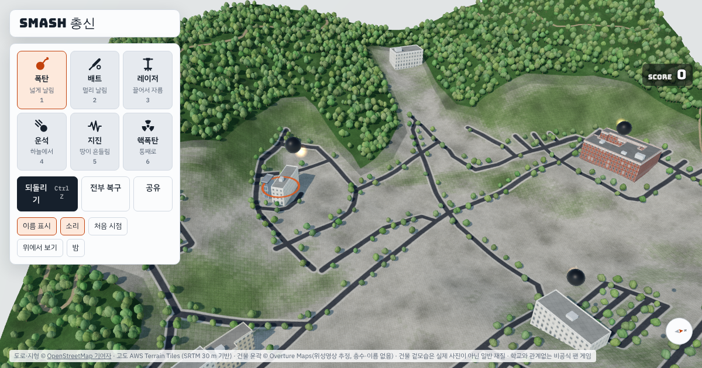

# SMASH 총신

총신대학교 신학대학원 양지캠퍼스를 3D로 부수는 브라우저 게임입니다. PC와 휴대폰 브라우저에서 설치 없이 할 수 있습니다.

학교와 관계없는 비공식 팬 게임입니다. [Hong-Iron/SMASH](https://github.com/Hong-Iron/SMASH) 시리즈의 게임 코드(`SMASH-SSU`)를 바탕으로 만들었습니다.

## 하는 법

- 도구 여섯 가지(폭탄·배트·레이저·운석·지진·핵폭탄)를 고르고 건물이나 땅을 누르면 부서집니다. 숫자 키 1~6으로도 바꿀 수 있습니다.
- PC: 끌기는 돌리기, 오른쪽 끌기는 옮기기, 휠은 확대입니다. 휴대폰: 한 손가락으로 끌어 옮기고, 두 손가락으로 돌리거나 확대합니다.
- 연속으로 부수면 스타일 랭크(D → SSS)와 점수가 오르고, 땅을 계속 파면 지구 중심까지 내려갑니다.
- 되돌리기(Ctrl+Z), 전부 복구, 밤 모드(N), 결과 카드 공유가 있습니다. 자세한 규칙은 원본 [SMASH-SSU README](https://github.com/Hong-Iron/SMASH-SSU)와 같습니다.

## 건물 데이터에 대해 (중요)

OpenStreetMap에는 총신대 양지캠퍼스의 건물 윤곽이 없습니다(캠퍼스 경계, 도로, 주차장만 있음). 그래서 건물은 [Overture Maps](https://overturemaps.org/)의 건물 데이터(위성영상으로 추정한 윤곽, release 2026-10-21.0, ODbL)에서 가져왔습니다.

- 캠퍼스 범위에서 **7동**만 잡혀 있고, 이름과 층수는 없습니다(층수는 4층으로 어림). 100주년기념예배당, 도서관 같은 큰 건물이 빠져 있을 수 있습니다.
- 윤곽 데이터는 `data/overture_buildings.json`에 있습니다. 건물마다 `name`, `levels`를 직접 적어 넣으면 이름 표시와 높이에 반영됩니다.
- 지형, 도로, 주차장, 나무는 OpenStreetMap과 고도 데이터에서 받은 실제 데이터입니다.
- 이전 버전에서 쓰던 임의 배치(실제 위치가 아님)는 이 데이터로 대체되어 없앴습니다.

### 건물을 더 정확하게 하려면

- [OpenStreetMap](https://www.openstreetmap.org/#map=17/37.2478/127.2994)에서 건물을 `building=yes`로 그려 넣으면 다음 빌드부터 쓰입니다.
- 또는 국토부 건물통합정보(VWorld 오픈API 키 필요)에서 윤곽·층수·이름을 받아 `data/overture_buildings.json` 형식으로 바꿔 넣을 수 있습니다.

## 만든 방법

- 페이지 만들기: `src/app.html` + `data/campus.json` + `config.json` → `python3 tools/assemble.py` → `site/index.html`
- 데이터 다시 만들기 (numpy, matplotlib 필요):
  1. `python3 tools/fetch_osm_api.py 616140735 raw` (OSM 편집 API 사용. Overpass가 열려 있으면 `tools/fetch.py way 616140735 raw`도 됩니다.)
  2. `python3 tools/inject_buildings.py raw` (`data/overture_buildings.json`의 건물 추가. OSM에 건물이 생기면 생략)
  3. `python3 tools/build_campus.py raw raw/campus_raw.json`
  4. `python3 tools/add_trees.py raw/campus_raw.json data/campus.json`
  5. `python3 tools/fix_terrain.py data/campus.json`
  6. `python3 tools/assemble.py`
- 3D는 three.js r160(CDN), 소리는 Web Audio로 합성합니다.
- `main`에 push하면 GitHub Actions가 `site/`를 GitHub Pages에 올립니다. 처음에는 저장소 Settings → Pages → Source를 **GitHub Actions**로 바꿔야 합니다.
- 랭킹 서버, 카카오 공유, 방문 통계는 `config.json`에 키를 넣으면 켜집니다. 지금은 모두 꺼져 있습니다.

## 데이터와 출처

- 캠퍼스 경계, 도로, 주차장, 녹지: © OpenStreetMap 기여자 (ODbL). 건물 윤곽: © Overture Maps Foundation (ODbL). `data/campus.json`도 ODbL을 따릅니다.
- 땅 높이: AWS Terrain Tiles (Mapzen terrarium 형식, SRTM 30 m 기반).
- 게임 코드와 변환 도구: [Hong-Iron/SMASH-SSU](https://github.com/Hong-Iron/SMASH-SSU)
- 건물 겉모습(창문, 벽돌, 유리)은 실제 사진이 아니라 코드로 그린 일반 재질입니다.
